<div align="center">

# Clawd Sticker Studio

**小小 Clawd，日常有戏。 / Little Clawd. Little everyday stories.**

24 款透明像素 GIF + 24 张 PNG · 24 transparent animated pixel stickers

[在线预览与下载 / Live gallery](https://aurora-eos.github.io/Clawd/) · [检查记录 / QA](QA.md)

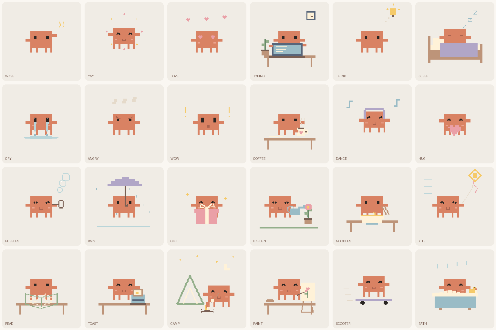

</div>

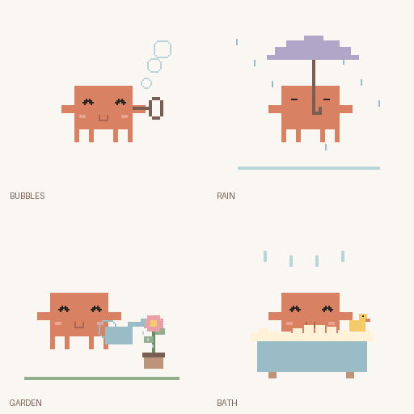

## 项目介绍 / About

受 Clawd 简洁造型启发的非官方像素表情项目：扁平橘色方块身体、四只细短脚、小眼睛，用生活道具和动作讲一个小故事。新版重新绘制全部角色，并扩展到 24 款，包含 15 个生活场景和 9 个情绪动作。

An unofficial fan-made collection built around a flat orange silhouette, four tiny feet and simple expressive eyes. Version 2 redraws the full character and expands the collection to 15 everyday scenes and 9 moods. Each scene is independently drawn in code, with transparent space around the artwork.

## 动态预览 / Animated collection

| 表情 / Scene | GIF 动态预览 | 下载 / Download |
|---|:---:|---|
| 深夜赶工 / Deadline |  | [GIF](gifs/typing.gif) · [PNG](png/typing.png) |
| 裹被睡觉 / Good night | 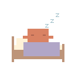 | [GIF](gifs/sleep.gif) · [PNG](png/sleep.png) |
| 咖啡续命 / Coffee | 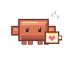 | [GIF](gifs/coffee.gif) · [PNG](png/coffee.png) |
| 午后吹泡泡 / Bubbles | 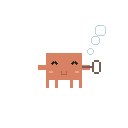 | [GIF](gifs/bubbles.gif) · [PNG](png/bubbles.png) |
| 雨天等你 / Rainy day | 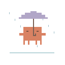 | [GIF](gifs/rain.gif) · [PNG](png/rain.png) |
| 礼物送给你 / For you | 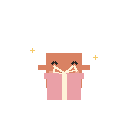 | [GIF](gifs/gift.gif) · [PNG](png/gift.png) |
| 浇花小能手 / Gardening | 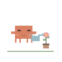 | [GIF](gifs/garden.gif) · [PNG](png/garden.png) |
| 嗦面暂停中 / Noodle break | 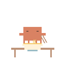 | [GIF](gifs/noodles.gif) · [PNG](png/noodles.png) |
| 去放风筝 / Windy day | 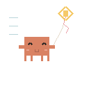 | [GIF](gifs/kite.gif) · [PNG](png/kite.png) |
| 窝着看书 / Reading | 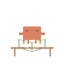 | [GIF](gifs/read.gif) · [PNG](png/read.png) |
| 早餐烤吐司 / Breakfast | 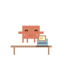 | [GIF](gifs/toast.gif) · [PNG](png/toast.png) |
| 星空小露营 / Camping | 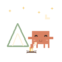 | [GIF](gifs/camp.gif) · [PNG](png/camp.png) |
| 画一朵小花 / Painting | 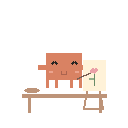 | [GIF](gifs/paint.gif) · [PNG](png/paint.png) |
| 滑板出发啦 / On my way | 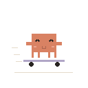 | [GIF](gifs/scooter.gif) · [PNG](png/scooter.png) |
| 泡个热水澡 / Bath time | 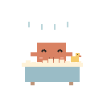 | [GIF](gifs/bath.gif) · [PNG](png/bath.png) |
| 探头打招呼 / Hello | 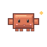 | [GIF](gifs/wave.gif) · [PNG](png/wave.png) |
| 开心蹦蹦 / Yay! | 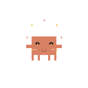 | [GIF](gifs/yay.gif) · [PNG](png/yay.png) |
| 偷偷比心 / Love | 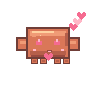 | [GIF](gifs/love.gif) · [PNG](png/love.png) |
| 灵感来了 / Thinking | 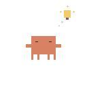 | [GIF](gifs/think.gif) · [PNG](png/think.png) |
| 哭成小水洼 / Sad | 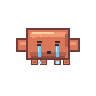 | [GIF](gifs/cry.gif) · [PNG](png/cry.png) |
| 气到冒烟 / Angry | 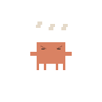 | [GIF](gifs/angry.gif) · [PNG](png/angry.png) |
| 吓到后退 / Wow | 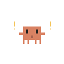 | [GIF](gifs/wow.gif) · [PNG](png/wow.png) |
| 耳机小舞步 / Dance | 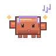 | [GIF](gifs/dance.gif) · [PNG](png/dance.png) |
| 给你抱抱 / Hug | 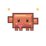 | [GIF](gifs/hug.gif) · [PNG](png/hug.png) |

## 使用 / Use

打开[画廊](https://aurora-eos.github.io/Clawd/)，可筛选场景或情绪、暂停播放、切换棋盘背景检查透明度，并下载原始 GIF 或 PNG。页面尊重系统“减少动态效果”设置。iPhone/iPad 若打开了图片，请长按保存或使用“分享 → 存储到文件”。聊天软件可能转换动图；以文件发送通常能保留原始格式。

Open the gallery to filter scenes and moods, pause animations, inspect transparency on a checkerboard and download GIF or PNG files. Reduced-motion preferences are respected. On iPhone/iPad, touch and hold an opened image or use Share → Save to Files. Receiving apps may convert animations; sending as a file usually preserves the original.

## 素材规格 / Asset specifications

- GIF: 128 × 128, transparent, infinite loop, 48 samples × 80 ms = 3.84 seconds. Identical adjacent frames can merge during encoding without changing playback duration.
- PNG: 512 × 512 RGBA, nearest-neighbor enlargement, transparent background.
- 动图为透明背景、无限循环；静态图使用最近邻放大，保留清晰像素边缘。

## 文件结构 / Files

```text
gifs/                         24 transparent GIFs / 透明动图
png/                          24 transparent PNGs / 透明静态图
preview/contact-sheet.png     Full collection / 素材总览
index.html                    Responsive gallery / 响应式画廊
render.py                     Reproducible drawing rig / 绘制源码
scripts/check_assets.py        Frame and alpha checks / 逐帧校验
.github/workflows/pages.yml   Validation + deployment / 校验与部署
QA.md                         Actual checks / 实际检查结果
```

## 本地运行 / Local development

```bash
python -m pip install -r requirements.txt
python render.py
python scripts/check_assets.py
python -m http.server 8000
```

打开 / Open `http://localhost:8000`. No API keys or external artwork needed. / 无需 API 密钥或外部图片。

## 非官方声明 / Fan-art notice

Independently drawn, unofficial fan art inspired by Clawd. Not affiliated with, sponsored or endorsed by Anthropic. Claude, Claude Code and Clawd identities belong to their respective owners. The MIT license covers project code; third-party mascot and trademark rights are excluded.

本项目为独立绘制的非官方同人作品，与 Anthropic 无关联、赞助或背书。MIT 许可覆盖项目代码，不包含第三方角色及商标权利。
